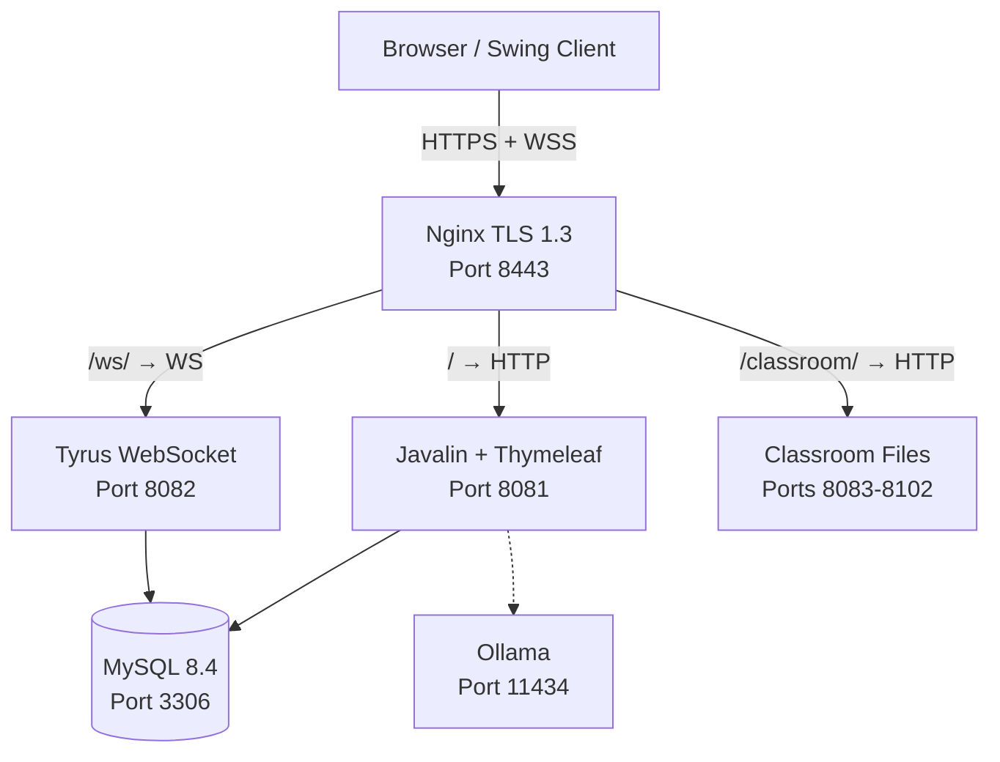

<h1 align="center">X-IDE</h1>

<p align="center">
  
</p>

<p align="center">
  <strong>A classroom IDE platform with web UI, WebSocket API, and desktop client</strong>
</p>

<p align="center">
  <a href="https://github.com/BrunoRNS/X-IDE/actions/workflows/ci.yml"></a>
  <a href="https://github.com/BrunoRNS/X-IDE/actions/workflows/develop-ci.yml"></a>
  <a href="https://github.com/BrunoRNS/X-IDE/actions/workflows/cd.yml"></a>
  <a href="https://github.com/BrunoRNS/X-IDE/blob/main/LICENSE"></a>
  <a href="https://www.java.com/"></a>
  <a href="https://maven.apache.org/"></a>
  <a href="https://docker.com/"></a>
</p>

---

## Overview

X-IDE is a **Java 17 Maven multi-module platform** designed for classroom programming environments. It provides:

- **Web Interface** — Javalin + Thymeleaf served over HTTPS
- **Real-time API** — Tyrus WebSocket server for live collaboration
- **Desktop Client** — Standalone Swing JAR with certificate pinning (TOFU)
- **Database** — MySQL 8.4 with auto-migration
- **AI Ready** — Optional Ollama integration for model-backed features
- **Single-Stack Deploy** — Docker Compose with Nginx TLS termination

All components run in one reproducible Docker/Podman Compose stack.

## Quick Start

```bash
# 1. Clone and enter
git clone https://github.com/BrunoRNS/X-IDE.git && cd X-IDE

# 2. Configure (creates .env from template)
make configure

# 3. Edit .env — REPLACE the example passwords
# DB_PASSWORD=your_password
# DB_ROOT_PASSWORD=your_root_password

# 4. Start the stack
make run-server
```

Open `https://localhost:8443/` (or `https://<LAN-IP>:8443/` from another device).  
The certificate is self-signed — verify the SHA-256 fingerprint printed at startup before accepting.

## Architecture



| Component | Technology | Port |
|-----------|------------|------|
| Reverse Proxy | Nginx (TLS 1.3) | 8443 (published) |
| Web Server | Javalin + Thymeleaf | 8081 (internal) |
| WebSocket | Tyrus | 8082 (internal) |
| Database | MySQL 8.4 | 3306 (internal) |
| AI (optional) | Ollama | 11434 (localhost) |
| Classroom Files | Static HTTP | 8083–8102 (published) |

## Project Structure

```
xide/
├── common/          # Shared protocol (SocketMessage, codec, router)
├── client/          # Swing desktop client (shaded JAR)
├── server/          # Web + WebSocket server (Javalin, Tyrus, MySQL)
├── infra/           # Docker, Compose, Nginx, release templates
├── scripts/         # Build helpers, release packaging
├── docs/            # Documentation
└── Makefile         # Command surface (build, test, run, package)
```

## Key Commands

| Category | Commands |
|----------|----------|
| **Build** | `build-all`, `package-server`, `package-client`, `package-server-bundles` |
| **Test** | `test-all`, `test-common`, `test-client`, `test-server`, `test-integration` |
| **Stack** | `run-server`, `run-dev-server`, `stop-server`, `server-logs`, `stack-status` |
| **Client** | `run-client`, `communication-test`, `remote-test URL=...` |
| **AI** | `run-model` (Ollama, default `qwen2.5-coder:3b`) |
| **Style** | `format` (rewrite), `lint` (validate), `imports-check` |

Run `make help` for the full command list with descriptions.

## Configuration

`make configure` creates `.env` from `.env.example`. Required variables:

| Variable | Description | Default |
|----------|-------------|---------|
| `DB_PASSWORD` | Application database password | **required** |
| `DB_ROOT_PASSWORD` | MySQL root password | **required** |
| `BIND_ADDRESS` | Interface for HTTPS port | `0.0.0.0` |
| `HTTPS_PORT` | Published HTTPS/WSS port | `8443` |
| `TLS_HOST` | Fixed certificate host (unset = auto-detect LAN IP) | auto |
| `CLASSROOM_PORT_RANGE` | Plain HTTP ports for hosted folders | `8083-8102` |

## Development Workflow

```bash
# Hot-reload for templates/static assets
make run-dev-server

# Edit server/src/main/resources/templates/*.html or public/*
# Changes appear on browser refresh (no rebuild)

# Rebuild Java changes
make package-server
docker compose --env-file .env -f infra/compose.yaml -f infra/compose.dev.yaml build app
```

## Security Model

- **TLS 1.3** terminated by Nginx (self-signed certificate, auto-generated)
- **TOFU pinning** in desktop client (`~/.xide/trusted-certificates.properties`)
- **Database** isolated in private Compose network
- **Ollama** bound to localhost only

> ⚠️ **Limitations**: Passwords stored as plain text. No rate limiting, auditing, or database TLS. Designed for trusted classroom LANs only. Do not expose port 8443 to the internet.

## Documentation

| Guide | Description |
|-------|-------------|
| [Getting Started](docs/getting-started/index.md) | Step-by-step setup |
| [Architecture](docs/architecture/overview.md) | System design and data flow |
| [Configuration](docs/reference/configuration.md) | All environment variables |
| [Commands](docs/reference/commands.md) | Complete Makefile reference |
| [WebSocket Protocol](docs/reference/websocket-protocol.md) | SocketMessage format and routes |
| [Security](docs/guides/security.md) | TLS, authentication, limitations |
| [Troubleshooting](docs/guides/troubleshooting.md) | Common issues |

## Releases

Pre-built bundles for offline deployment:

```bash
# Client bundles (all platforms via jpackage)
make package-client

# Server bundles (multi-arch Docker images)
make package-server-bundles
```

GitHub Actions builds on every push:
- **CI** — Lint, test, package on feature branches
- **Develop CI** — Full matrix on `develop` branch
- **CD** — Docker Hub publish + GitHub Release on tags

## License

**BSD 3-Clause** — see [LICENSE](LICENSE) for details.

---

<p align="center">
  <sub>Built for classroom environments. Not a sandbox for untrusted code execution.</sub>
</p>