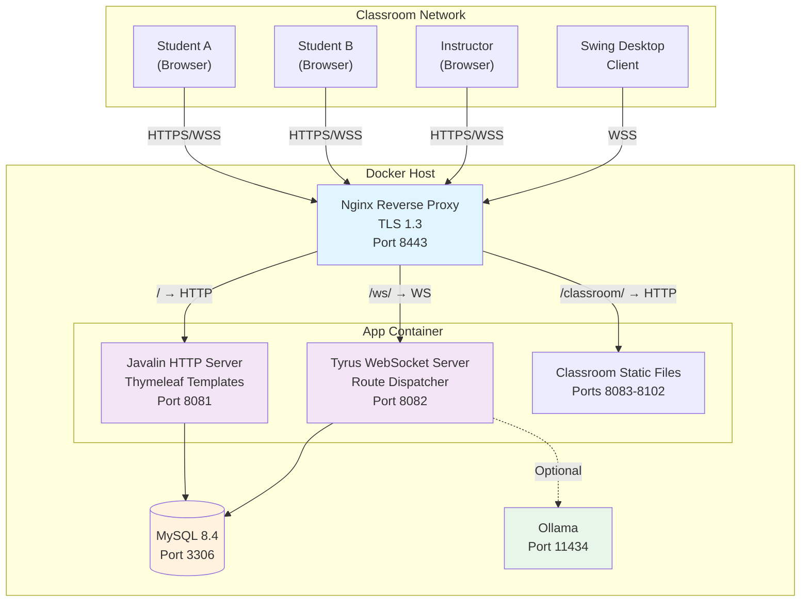
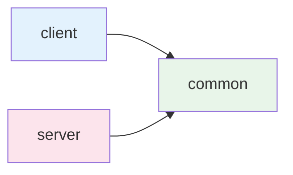
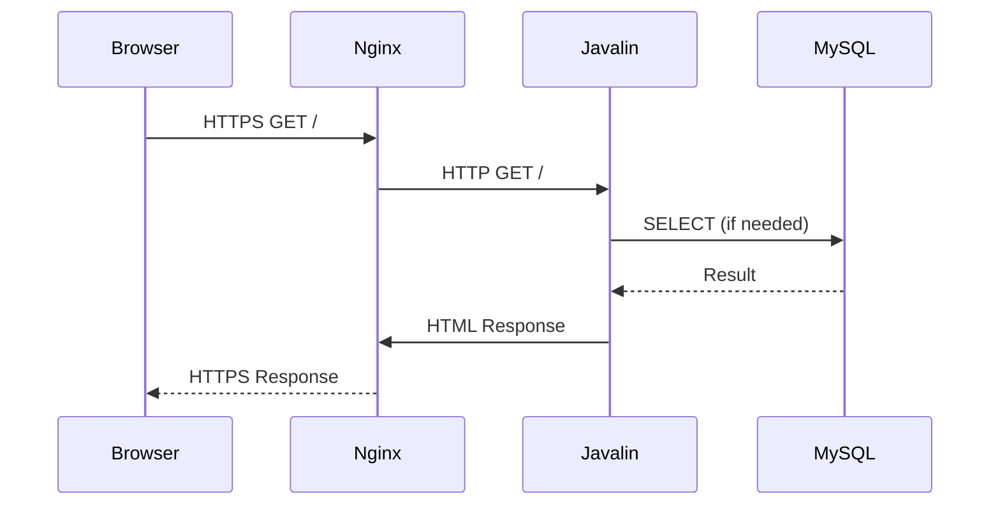
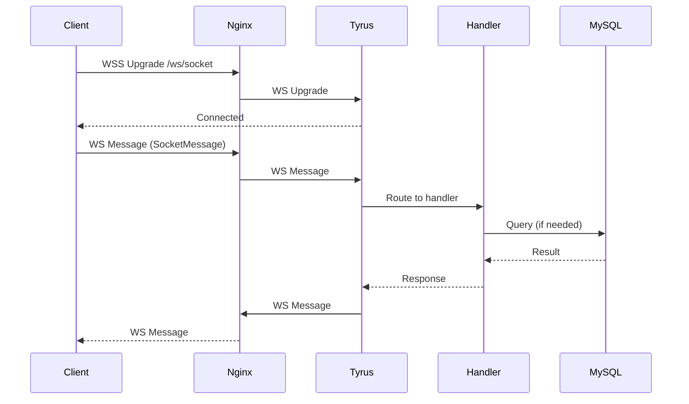
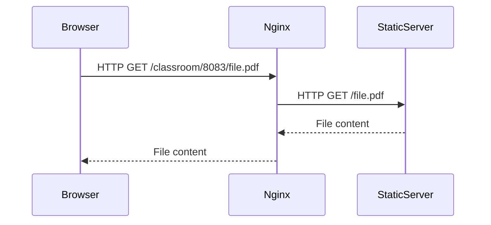
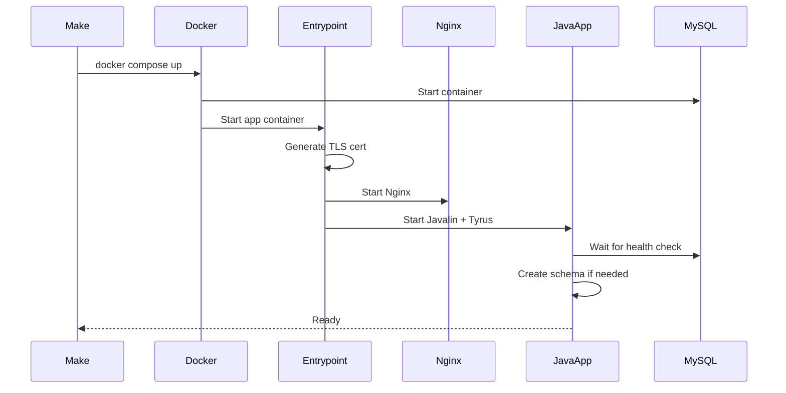

# Architecture Overview

## High-Level Diagram



## Component Details

### 1. Nginx Reverse Proxy (Port 8443)

Nginx serves as the single entry point for all external traffic:

- **TLS Termination**: Handles TLS 1.3 connections, offloading encryption from the Java application
- **Certificate Management**: Generates self-signed certificate on first start via entrypoint script
- **Request Routing**:
  - `/` and static assets → Javalin (port 8081)
  - `/ws/` → Tyrus WebSocket (port 8082)
  - `/classroom/<port>/` → Static file server (ports 8083-8102)
- **Security Headers**: Adds HSTS, X-Frame-Options, CSP headers
- **WebSocket Upgrade**: Properly handles Connection: Upgrade for WebSocket connections

The Nginx configuration is generated at container startup by `infra/nginx/docker-entrypoint.sh`, which:
1. Detects or uses `TLS_HOST` for certificate SAN
2. Generates RSA 2048-bit certificate with OpenSSL
3. Writes Nginx configuration with correct upstream paths
4. Starts Nginx in foreground

### 2. Javalin HTTP Server (Port 8081)

The Javalin server runs on `127.0.0.1:8081` (internal only) and provides:

- **Template Rendering**: Thymeleaf templates in `server/src/main/resources/templates/`
- **Static Assets**: CSS, JS, images from `server/src/main/resources/public/`
- **REST Endpoints**: JSON APIs for web UI interactions
- **Session Management**: In-memory session store for authenticated users
- **File Upload Handling**: Multipart form processing for classroom materials

Key controllers:
- `HomeController` - Home page, dashboard
- `StudentController` - Student listing, registration
- `ClassroomController` - Classroom folder management, port assignment
- `UploadController` - File upload handling

### 3. Tyrus WebSocket Server (Port 8082)

The Tyrus server runs on `127.0.0.1:8082` (internal only) and handles:

- **Connection Lifecycle**: Open, message, close, error events
- **Route-Based Dispatch**: Annotations map routes to handler methods
- **Session Registry**: In-memory map of connected clients by session ID
- **Message Broadcasting**: Push messages to all or specific clients
- **Authentication Integration**: Validates sessions on connect

WebSocket endpoints are defined in `server/src/main/java/org/xide/sockets/endpoints/` using the `@WebSocketEndpoint` and `@WebSocketRoute` annotations from the common module.

### 4. MySQL Database (Port 3306)

MySQL 8.4 runs in a separate container, accessible only within the Compose network:

- **Schema Management**: Tables auto-created on startup via JPA/Hibernate
- **Connection Pool**: HikariCP with 10 connections
- **Character Set**: utf8mb4 with utf8mb4_unicode_ci collation
- **Timezone**: UTC (configured in Compose)

Core tables:
- `users` - Student/instructor accounts
- `problems` - Programming problems
- `restrictions` - Problem constraints
- `problem_times` - Time limits
- `solutions` - Submitted solutions
- `code` - Source code submissions
- `submissions` - Submission records with status

### 5. Ollama (Port 11434, Optional)

Ollama runs in a separate container, published only on localhost:

- **CPU Mode**: No GPU required, runs on any architecture
- **Model Management**: Pulls model on first start (`qwen2.5-coder:3b` by default)
- **API Compatibility**: OpenAI-compatible `/v1/chat/completions` endpoint
- **Resource Usage**: ~2-4 GB RAM depending on model
- **Integration**: Communicates via WebSocket through Tyrus server (not direct HTTP). WebSocket handlers in the server module proxy requests to Ollama's local API endpoint.

Started separately with `make run-model`. Not required for core functionality.

### 6. Swing Desktop Client

Standalone shaded JAR (`client/target/client-all.jar`):

- **Connection**: WSS to `/ws/socket` endpoint
- **Certificate Pinning**: TOFU (Trust On First Use) model
- **Pin Storage**: `~/.xide/trusted-certificates.properties`
- **Automation Support**: `XIDE_TLS_FINGERPRINT` environment variable
- **Message Format**: Uses `SocketMessage` protocol from common module

## Module Structure

```
xide/
├── common/                 # Shared protocol
│   └── src/main/java/org/xide/
│       ├── protocol/       # SocketMessage, codec
│       └── sockets/        # Annotations, router, scanner
├── client/                 # Swing desktop client
│   └── src/main/java/org/xide/
│       ├── client/         # Main, socket client
│       ├── config/         # Client configuration
│       ├── controller/     # UI controllers
│       ├── frame/          # Swing frames/holders
│       └── ui/             # UI components, menu
├── server/                 # Web + WebSocket server
│   └── src/main/java/org/xide/
│       ├── http/           # Javalin controllers, DTOs, services
│       ├── models/         # JPA entities, enums
│       ├── repository/     # MySQL repositories
│       ├── sockets/        # WebSocket controllers, endpoints
│       ├── states/         # Session/application state
│       └── utils/          # Utilities
├── infra/                  # Infrastructure
│   ├── compose.yaml        # Main Compose stack
│   ├── compose.dev.yaml    # Dev overlay (bind mounts)
│   ├── Dockerfile          # Server Docker image
│   ├── Dockerfile.ai       # Ollama Docker image
│   ├── nginx/              # Nginx config, entrypoint
│   └── release/            # Release bundle templates
├── scripts/                # Build/release helpers
│   ├── JavaImportFormatter.java
│   ├── package-client.py
│   ├── package-server.py
│   └── package-release.sh
├── docs/                   # Documentation
└── Makefile                # Command surface
```

### Module Dependencies



- **common**: No dependencies. Contains `SocketMessage`, codec, WebSocket annotations, router, scanner.
- **client**: Depends on common. Builds shaded JAR with all dependencies.
- **server**: Depends on common. Builds shaded JAR for Docker image.

## Data Flow

### HTTP Request (Web UI)



### WebSocket Message



### Classroom File Access



## Security Boundaries

| Boundary | Protection |
|----------|------------|
| External → Nginx | TLS 1.3, self-signed certificate |
| Nginx → App | Internal Docker network, no TLS |
| App → MySQL | Internal Docker network, password authentication |
| App → Ollama | Via Tyrus WebSocket (localhost only, no authentication) |
| Client → Server | WSS + TOFU pinning |

### TLS Configuration

Nginx enforces TLS 1.3 only:

```nginx
ssl_protocols TLSv1.3;
ssl_ciphers HIGH:!aNULL:!MD5;
ssl_prefer_server_ciphers on;
```

Certificate details:
- Self-signed RSA 2048-bit
- SAN: TLS_HOST (or auto-detected LAN IP), localhost, 127.0.0.1
- Validity: 365 days
- Regenerated automatically on IP change (when TLS_HOST unset)

### TOFU Pinning (Desktop Client)

The Swing client implements Trust On First Use:

1. First connection: Server certificate fingerprint (SHA-256) displayed to user
2. User verifies fingerprint matches server output
3. Fingerprint stored in `~/.xide/trusted-certificates.properties`
4. Subsequent connections: Certificate must match stored fingerprint
5. Mismatch: Connection refused, user must manually remove pin

For automation, set `XIDE_TLS_FINGERPRINT` to the expected SHA-256 fingerprint.

## Deployment Modes

### Development (`run-dev-server`)

```bash
make run-dev-server
```

- Bind-mounts `server/src/main/resources` into container
- Thymeleaf cache disabled (`spring.thymeleaf.cache=false`)
- Template and static asset changes visible on browser refresh
- Java source changes require rebuild: `make package-server && docker compose ... build app`
- Uses `infra/compose.dev.yaml` overlay

### Production (`run-server`)

```bash
make run-server
```

- No bind mounts
- Uses built Docker image
- Persistent TLS certificate in `tls_certs` volume
- Database in `mysql_data` volume
- Uploads in `uploads_data` volume
- Uses `infra/compose.yaml`

### Release Bundles (`package-server-bundles`)

```bash
make package-server-bundles
```

Four ZIPs: `full` (server + AI + database), `site` (server only, external DB),
`ai` (Ollama) and `database` (MySQL). Each contains:

- Pre-built Docker images as `.tar` archives (GraalVM native server, no JVM)
- Compose files without `build:` sections
- Generic launchers (`run.sh`, `run.cmd`, `run.ps1`)
- Works on Linux, macOS, Windows with Docker Desktop

The `full` and `site` bundles share one native server image, built once per platform.

## Network Ports

| Port | Service | Protocol | Exposure |
|------|---------|----------|----------|
| 8443 | Nginx HTTPS/WSS | TCP | Published (LAN) |
| 8081 | Javalin HTTP | TCP | Internal only |
| 8082 | Tyrus WebSocket | TCP | Internal only |
| 3306 | MySQL | TCP | Internal only |
| 11434 | Ollama | TCP | Localhost only |
| 8083-8102 | Classroom files | TCP | Published (LAN) |

## Persistence

| Volume | Purpose | Survives `down -v` |
|--------|---------|-------------------|
| `mysql_data` | Database | No - deleted |
| `uploads_data` | User uploads | No - deleted |
| `tls_certs` | TLS certificates | No - deleted |
| `ollama_data` | AI models | No - deleted |

### Volume Management

```bash
# List volumes
docker volume ls | grep xide

# Inspect volume
docker volume inspect xide_mysql_data

# Backup volume
docker run --rm -v xide_mysql_data:/data -v $(pwd):/backup alpine tar czf /backup/mysql.tar.gz -C /data .

# Restore volume
docker run --rm -v xide_mysql_data:/data -v $(pwd):/backup alpine tar xzf /backup/mysql.tar.gz -C /data
```

## Startup Sequence



1. `make run-server` validates `.env` and runs `docker compose up`
2. MySQL container starts, runs health check
3. App container starts, runs entrypoint script:
   - Generates/loads TLS certificate
   - Starts Nginx
   - Starts Java application (Javalin + Tyrus)
4. Java application waits for MySQL to be healthy
5. Schema auto-created if missing
6. Server ready to accept connections