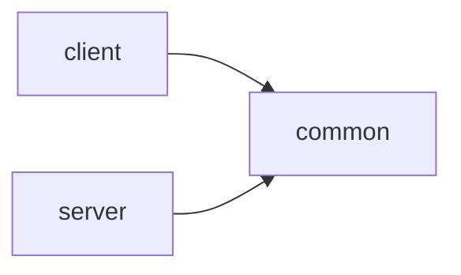

# Development and Contribution Guide

This guide explains how X-IDE is organized, which patterns the code follows, and how to propose a change through a pull request (PR). Start with [Getting Started](getting-started/index.md) if you have not run the project yet.

> **Source of truth:** the Java sources, tests, `Makefile`, and `package-info.java` files are authoritative. A few older pages still describe an earlier design (for example JPA/Hibernate persistence or a different `SocketMessage` shape). When documentation and code disagree, follow the code and include the correction in your PR.

## Contents

- [Module boundaries](#module-boundaries)
- [Design patterns used in the code](#design-patterns-used-in-the-code)
- [Local development workflow](#local-development-workflow)
- [Testing expectations](#testing-expectations)
- [Code style and documentation](#code-style-and-documentation)
- [Branching and commits](#branching-and-commits)
- [Pull requests](#pull-requests)
- [Security and configuration](#security-and-configuration)
- [Common pitfalls](#common-pitfalls)

## Module boundaries

X-IDE is a Java 17 Maven multi-module project. The dependency direction is deliberately one-way:



| Directory | Responsibility | Depends on |
|---|---|---|
| `common/` | Shared `SocketMessage` protocol, codec, WebSocket annotations, router, and scanner | Nothing internal |
| `server/` | Javalin HTTP site, Tyrus WebSocket server, JDBC repositories, competition state | `common` |
| `client/` | Swing desktop client, Tyrus client, TLS pinning, UI frames | `common` |
| `infra/` | Docker, Compose, Nginx, release templates | — |
| `scripts/` | Import formatter and release helpers | — |
| `docs/` | Documentation | — |

Rules to preserve:

- Shared protocol types and routing annotations belong in `common`. Never duplicate `SocketMessage` or hand-roll a competing JSON frame format in `server` or `client`.
- `common` must not import from `server` or `client`. Tests in `common` mirror production endpoints locally instead of depending on those modules.
- New server-side behavior goes under `server/src/main/java/org/xide/` in the matching package (`http`, `models`, `repository`, `sockets`, `states`, `utils`); new client behavior goes under `client/src/main/java/org/xide/` (`actions`, `client`, `config`, `controller`, `frame`, `ui`).
- Keep SQL in `server/src/main/resources/sql/` and load it with `SqlUtil.readSqlToString(...)` rather than embedding large queries in Java.

For the deployment-level view, see [Architecture Overview](architecture/overview.md).

## Design patterns used in the code

### Layered HTTP server

The web site runs on Javalin (internal port 8081). HTTP routes are registered centrally in `server/src/main/java/org/xide/http/routers/Routers.java`; individual handlers are static methods on controller classes in `http/controllers/`.

- Handlers receive `io.javalin.http.Context` and render Thymeleaf templates or return JSON.
- Validation happens early; errors use `Map.of("error", "...")` with an explicit status (`400`, `404`, `500`, ...).
- Business logic lives in `http/service/` classes, usually `final` utility classes with private constructors.
- Data access lives in `repository/` classes. The current implementation uses explicit JDBC through `Connection.connect()` and `SqlUtil`, with manual transactions for multi-statement writes. Do not introduce a new persistence framework in a small change.
- DTOs are records grouped in holder classes such as `http/dto/ProblemDtos.java`; persistent models in `models/` remain mutable POJOs with getters/setters.

When adding an HTTP endpoint, register it in `Routers`, keep the handler thin, and add an integration test that starts Javalin on port `0`.

### Annotation-driven WebSocket routing

WebSocket routes are discovered, not hard-coded in a switch statement:

- `@WebSocketController` marks a class. It must have a **public no-argument constructor** because the scanner instantiates it through reflection.
- `@WebSocketRoute("/some/path")` marks a public handler method. The path must be absolute. Set `protectedRoute = true` when a logged-in session is required.
- `@SocketParam("field")` binds a named field of the message payload to a method parameter.
- Handler parameters may only be `SocketMessage`, `jakarta.websocket.Session`, or a parameter annotated with `@SocketParam`.
- `WebSocketScanner` uses ClassGraph to find controllers in the `org.xide` package and registers them in deterministic class-name order. `WebSocketRouter` rejects duplicate routes.
- `SocketMessageCodec.decode(...)` and `encode(...)` are the only supported ways to translate frames.
- The router wraps a non-null handler result with `SocketMessage.response(request.route(), ...)`. Returning `null` or `void` means "no reply"; use a push message instead when you need to notify clients.
- The server endpoint checks `protectedRoute` before dispatch and sends errors as `SocketMessage.response("/error", ...)`.
- Client-side handlers live in `client/src/main/java/org/xide/controller/` and follow the same annotations; inbound messages are queued by route for `WebSocketClient.receive(route, timeout, unit)` and then dispatched to matching client controllers.

A minimal server controller looks like this:

```java
@WebSocketController
public final class ExampleSocketController {

	@WebSocketRoute("/develop/ping")
	public String ping(SocketMessage request) {
		return SocketMessage.PONG;
	}

	@WebSocketRoute("/example/echo", protectedRoute = true)
	public String echo(@SocketParam("message") String message) {
		return message;
	}
}
```

The wire format is the record `SocketMessage(String route, JsonNode payload, boolean response)`. Use its factories (`text`, `response`, `textResponse`) and `SocketMessageCodec.toJsonNode(...)` for payloads. Do not add `type`, `messageId`, or `timestamp` fields: the protocol reference page predates the current record.

See [WebSocket Protocol Reference](reference/websocket-protocol.md) for the route catalogue, but verify payload shapes against the controller source before changing them.

### Server roles and state

`Main` starts the Javalin site and Tyrus endpoint according to `XIDE_SERVER_ROLE` (`FULL`, `SITE`, or `WEBSOCKET`; unset means `FULL`). Keep new work in the correct role: site-only code must not be required by the WebSocket role, and vice versa.

Live state is held in dedicated classes such as `ClientSessions` (sessions, login status, last pong) and `CompetitionState`. Use thread-safe collections for anything touched by WebSocket threads, and make mutable global state resettable in tests (`@BeforeEach`/`@AfterEach`). Do not add mutable static fields to controllers.

### Swing client patterns

- `WebSocketClient` is a singleton; obtain it with `getInstance()` or `getInstance(uri)`.
- UI actions live in `actions/` (for example `Login`), route handlers in `controller/`, windows in `frame/`, and reusable components in `ui/`.
- Window lifecycle is managed by static holders in `frame/holders/`. Use `FrameHolderSupport.runOnEventDispatchThread(...)` when touching Swing components from a socket thread; run slow work off the EDT and return to the UI with `SwingUtilities.invokeLater`.
- TLS uses Trust On First Use (TOFU) pinning in `client/tls/ServerCertificateTrustManager`. Keep the pin check intact; `XIDE_TLS_FINGERPRINT` exists only for non-interactive deployments.

### Compatible naming

Several identifiers and routes are intentionally spelled as they are (`ProblensController`, `Soluction`, `sucess` in login payloads, and similar). They are part of the current UI/database/protocol contract. Do not rename one side in isolation; if you migrate a spelling, update every caller, test, SQL file, and document in the same PR and call out the breaking change.

## Local development workflow

Prerequisites are listed in [Getting Started](getting-started/index.md): JDK 17+, Docker with Compose v2, GNU Make, Git, and Bash for some scripts.

```bash
git clone https://github.com/BrunoRNS/X-IDE.git
cd X-IDE
make configure          # creates .env; replace the example passwords
make run-dev-server     # hot reload for templates and static assets
```

The usual edit/verify loop is:

```bash
make build-all          # compile every module
make lint               # import order + Spring Java Format check
make test-common
make test-client
make test-server
```

Useful commands (full list in [Command Reference](reference/commands.md) and [Makefile Commands](makefile.md)):

| Command | Use it when |
|---|---|
| `make format` | Rewriting Java sources and import order before committing |
| `make lint` | Checking formatting/imports locally (same check as CI `validate`) |
| `make run-dev-server` | Editing templates or `public/` assets; changes appear on refresh |
| `make package-server` | After Java changes, before rebuilding the server image |
| `make run-client` | Smoke-testing a WebSocket route from the desktop client |
| `make communication-test` | Verifying ping/pong through the full stack |
| `make test-integration` | Running the Docker-backed client integration test |

Java source changes require a rebuild of the server image; bind mounts only cover resources. Do not commit `.env`, `target/`, bundled JARs, TLS certificates, or local logs.

### Releasing a version

The root `VERSION` file is the single source of truth for release packaging. Run `make version V=v1.2.3` (or `make version v1.2.3`) before tagging a release; without an argument, the target uses the highest local `vX.Y.Z` tag and fails if there is none. It updates `VERSION`, the parent/module versions in all four POMs, and the constant printed by the client's `--version` flag. It never rewrites `@since` Javadoc tags. Jar filenames stay stable (`client-all.jar` and `server.jar`) because the POMs set `<finalName>` and the client shade plugin writes to a fixed `outputFile`, so no launcher or Dockerfile change is needed. Verify with `make version-check`.

## Testing expectations

Every behavioral change needs a test in the matching module, under `src/test/java/org/xide/...` mirroring the production package.

- Use JUnit 5. Name test classes `*Test` and keep tests independent of each other.
- Unit tests must not require Docker or a running server. Existing tests use nested `@WebSocketController` fixtures, fake JDBC drivers via dynamic proxies, and package-visible seams that can be swapped in a test.
- HTTP integration tests start Javalin with `.start(0)` and use `java.net.http.HttpClient`; they save and restore any system properties they change.
- The client integration test (`ClientServerConnectionTest`) is disabled unless the system property `socket.it=true` is set; `make test-integration` provides it and manages the Compose stack.
- Never use `Thread.sleep` to wait for asynchronous work. Use Awaitility, which is version-managed in the parent POM:

```java
await().atMost(10, TimeUnit.SECONDS)
	.pollInterval(200, TimeUnit.MILLISECONDS)
	.ignoreExceptions()
	.untilAsserted(() -> {
		SocketMessage response = client.receive("/develop/ping", 1, TimeUnit.SECONDS);
		assertEquals(SocketMessage.textResponse("/develop/ping", SocketMessage.PONG), response);
	});
```

- Reset mutable global state (`CompetitionState`, test controllers, static holders) before and after each test.
- WebSocket route tests should cover successful dispatch, payload binding, protected-route behavior, and duplicate/unknown routes where relevant.

CI runs `./mvnw -B -ntp validate` and `./mvnw -B -ntp -pl <module> -am test` for `common`, `client`, and `server` on Ubuntu, macOS, and Windows. Make sure your tests pass on all three platforms: use `java.nio.file.Path`, avoid hard-coded path separators, and do not rely on a POSIX-only shell in unit tests.

## Code style and documentation

- Java 17 language level; Maven Enforcer rejects older JDKs and the compiler runs with `-Xlint:all`. Fix new warnings instead of suppressing them broadly.
- All text files use LF line endings, enforced by `.gitattributes` and `scripts/line_endings.py`. `make format` normalizes them; `make lint` fails on any CR byte in a text file. Binary assets are skipped.
- Spring Java Format `0.0.48` with tabs (see `.springjavaformatconfig`). Run `make format`, then `make lint` before pushing.
- Import groups are enforced by `scripts/JavaImportFormatter.java`: `java.*`, `javax.*`, static imports, everything else, then `io.simpleide.*`, with a blank line between groups.
- Add or update `package-info.java` for new packages, and document public classes with a short Javadoc summary plus `@since` and `@author` tags, following nearby files.
- Update the relevant page in `docs/` when behavior, routes, configuration, or commands change. Add a link from [Documentation Index](index.md) for new guides.
- Keep commits and PRs focused; unrelated formatting churn makes review harder.

## Branching and commits

`develop` is the integration branch for normal work; `main` represents released code. Open feature/fix PRs against `develop`, never directly against `main` unless a maintainer explicitly asks for a hotfix.

Branch names observed in this repository use a prefix plus a short topic:

```text
feature/<topic>      # new capability, e.g. feature-auth
fix/<topic>          # bug fix
chore/<topic>        # tooling, refactoring, CI
docs/<topic>         # documentation only
```

Before starting:

```bash
git switch develop
git pull --ff-only origin develop
git switch -c feature/<topic>
```

Commit messages follow Conventional Commits and describe the change in the imperative mood:

```text
feat(auth): track the logged-in user per WebSocket session
fix(ci): use the Maven Central mirror for the wrapper
docs: add development and contribution guide
test(router): cover duplicate route registration
```

Use `feat:`, `fix:`, `docs:`, `test:`, `refactor:`, `chore:`, `ci:`, `build:`, or `perf:` as the type. Keep one logical change per commit; put the motivation and any migration notes in the body when the "why" is not obvious. Avoid vague messages such as `wip` or unrelated edits in the same commit.

Sync a long-running branch with `git fetch origin && git rebase origin/develop` rather than merging `develop` repeatedly. If you rewrite commits that were already pushed, tell reviewers before force-pushing.

## Pull requests

1. **Prepare.** Branch from an up-to-date `develop`, implement the change, add tests and docs, and run `make lint` plus the affected `make test-*` targets.
2. **Push and open the PR.** Target `develop`. Link the issue it closes and mark it as a draft while the work is incomplete.
3. **Describe the change.** Use this structure in the PR body:

   ```markdown
   ## Summary
   What changed and why.

   ## Related issue
   Closes #123

   ## Type of change
   - [ ] Feature / fix / refactor / docs / build or CI

   ## How it was tested
   Commands run and manual checks performed.

   ## Protocol, data, or configuration impact
   Routes, payloads, SQL schema, `.env` keys, or breaking changes (and migration steps).

   ## Checklist
   - [ ] `make lint` passes
   - [ ] Relevant `make test-*` targets pass
   - [ ] New or updated tests are included
   - [ ] Documentation is updated
   - [ ] No secrets, generated files, or local configuration are committed
   ```

4. **Expect CI.** PRs targeting `develop` run `.github/workflows/develop-ci.yml`; PRs targeting other feature branches run `.github/workflows/ci.yml`. Both validate formatting, test all modules across three operating systems, and build the client and server bundles. Pushes to `main`/`develop` and `v*.*.*` tags run `.github/workflows/cd.yml` for publishing, so contributors should not push to those branches directly.
5. **Review.** Keep the discussion in the PR, answer review comments with commits or clear replies, and re-run the checks after each update. Small follow-up commits are fine; maintainers may ask for a rebase or squash before merge.
6. **After merge.** Delete the branch, watch the integration pipeline, and follow up if a release note or documentation fix is needed.

A PR is ready for review when the code is formatted, the tests pass locally and in CI, the change is scoped to one purpose, and a reviewer can understand the behavior from the description and diff alone.

## Security and configuration

- `.env` is local configuration. Copy it from `.env.example`, replace every placeholder password, and never commit or paste its values into a PR, issue, or log.
- Keep database and other internal services on the private Compose network. Do not publish port 8443 to the internet; see [Security Guide](guides/security.md).
- Do not weaken WebSocket TLS pinning, disable authentication checks on protected routes, or log credentials and raw session tokens.
- Prefer additive schema and protocol changes. If a change is incompatible, describe the migration in the PR and keep older clients in mind.
- The project targets a trusted classroom LAN. Security limitations are documented in [Security Guide](guides/security.md); do not silently introduce a new externally reachable endpoint.

## Common pitfalls

| Symptom | Likely cause |
|---|---|
| CI fails at `validate` | Run `make format`; check tabs and import groups |
| `IllegalStateException: duplicate route` | Two `@WebSocketRoute` methods share a path, or a route was registered twice |
| `NoSuchMethodException` during scanning | A `@WebSocketController` lacks a public no-argument constructor |
| `IllegalArgumentException` for a payload field | Missing `@SocketParam` name, wrong declared type, or JSON `null` bound to a primitive |
| Protected route still reachable without login | The handler has `protectedRoute = false`; enforcement happens in the server endpoint |
| Flaky WebSocket test | A fixed sleep was used instead of Awaitility, or global state was not reset |
| Java edits do not appear in dev mode | Only resources are bind-mounted; rebuild with `make package-server` and rebuild the image |
| Broken links from older docs | Some referenced files do not exist yet; add the missing page or update the link in the same PR |
