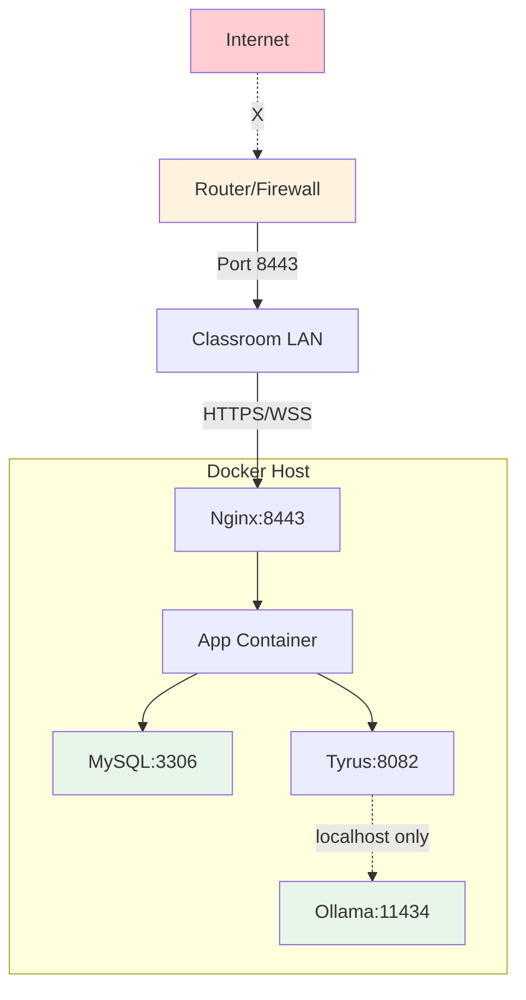

# Security Guide

## Overview

X-IDE is designed for trusted classroom LAN environments. This document describes the security model, current protections, and known limitations.

## Current Security Measures

### Transport Security

- **TLS 1.3 Only**: Nginx configured to accept only TLS 1.3 connections
- **Strong Ciphers**: High-grade cipher suites, no NULL or anonymous ciphers
- **Certificate Pinning**: Desktop client implements TOFU (Trust On First Use) pinning
- **Self-Signed Certificates**: Generated on first start, regenerated on IP change

### Network Isolation



- **MySQL**: Private Compose network only, no published ports
- **Ollama**: Bound to `127.0.0.1:11434` only; accessed via Tyrus WebSocket handlers
- **Internal Services**: Javalin (8081) and Tyrus (8082) not exposed outside container
- **Classroom Files**: Plain HTTP on ports 8083-8102, LAN only

### Certificate Management

#### Generation Process

1. Entrypoint script detects `TLS_HOST` or auto-detects LAN IP
2. OpenSSL generates RSA 2048-bit key pair
3. Self-signed X.509 certificate with SANs:
   - TLS_HOST (or auto-detected IP)
   - localhost
   - 127.0.0.1
4. Certificate stored in `tls_certs` Docker volume
5. Nginx configured with certificate and key paths

#### TOFU Pinning (Desktop Client)

```
First Connection:
1. Client receives server certificate
2. SHA-256 fingerprint calculated
3. Fingerprint displayed to user
4. User verifies against server output
5. Fingerprint stored in ~/.xide/trusted-certificates.properties

Subsequent Connections:
1. Client receives server certificate
2. Fingerprint compared to stored value
3. Match: Connection proceeds
4. Mismatch: Connection refused, manual intervention required
```

#### Automation Support

For non-interactive deployments, set `XIDE_TLS_FINGERPRINT`:

```bash
export XIDE_TLS_FINGERPRINT="a1:b2:c3:d4:e5:f6:..."
java -jar client.jar --endpoint wss://server:8443/ws/socket /route
```

## Known Limitations

### Critical Limitations

| Limitation | Impact | Mitigation |
|------------|--------|------------|
| Plain text passwords | Database compromise exposes all credentials | Use only in trusted LAN; plan for bcrypt/Argon2 migration |
| No rate limiting | Brute force attacks possible | Deploy behind firewall with rate limiting |
| No audit logging | No trail of security events | Add audit logging to authentication endpoints |
| No database TLS | MySQL traffic unencrypted in Docker network | Use Docker network encryption or VPN |
| No session timeout | Sessions persist indefinitely | Implement session expiry and renewal |
| No account lockout | Unlimited login attempts | Add failed attempt tracking and lockout |

### Architecture Limitations

| Limitation | Description |
|------------|-------------|
| Self-signed certificates | No CA validation; vulnerable to MITM if first connection intercepted |
| In-memory session store | Sessions lost on restart; no distributed session support |
| No CSP for dynamic content | Thymeleaf templates may allow XSS if not careful |
| No input validation framework | Relies on manual validation in controllers |

## Recommended Hardening

### For Production Classroom Use

1. **Password Hashing**
   ```java
   // Add to UserRepository or authentication service
   PasswordEncoder encoder = new BCryptPasswordEncoder(12);
   String hashed = encoder.encode(rawPassword);
   boolean matches = encoder.matches(rawPassword, hashed);
   ```

2. **Rate Limiting**
   ```java
   // Add to Javalin configuration
   app.before(ctx -> {
       RateLimiter limiter = RateLimiter.create(10.0); // 10 req/s per IP
       if (!limiter.tryAcquire()) {
           ctx.status(429).result("Too many requests");
       }
   });
   ```

3. **Session Management**
   ```java
   // Add session expiry
   @WebSocketRoute("/auth/login")
   public SocketMessage login(...) {
       Session session = createSession(userId, Duration.ofHours(8));
       return response(Map.of("sessionToken", session.getToken()));
   }
   ```

4. **Database TLS**
   ```yaml
   # In compose.yaml
   mysql:
     command: --require_secure_transport=ON
     # Add CA cert, client cert, client key as volumes
   ```

5. **Content Security Policy**
   ```nginx
   # In nginx.conf
   add_header Content-Security-Policy "default-src 'self'; script-src 'self' 'unsafe-inline'; style-src 'self' 'unsafe-inline';";
   ```

6. **Audit Logging**
   ```java
   // Log security events
   auditLog.info("AUTH_SUCCESS user={} ip={}", userId, clientIp);
   auditLog.warn("AUTH_FAILURE ip={} reason={}", clientIp, reason);
   ```

### Network Hardening

1. **Firewall Rules**
   ```bash
   # Allow only classroom subnet
   iptables -A INPUT -s 192.168.1.0/24 -p tcp --dport 8443 -j ACCEPT
   iptables -A INPUT -p tcp --dport 8443 -j DROP
   
   # Block Docker port bypass
   iptables -I DOCKER-USER -i ext_if ! -s 192.168.1.0/24 -j DROP
   ```

2. **VLAN Isolation**
   - Place student devices on guest VLAN
   - Restrict VLAN to only reach instructor Docker host
   - Block inter-student communication if not needed

3. **Docker Network Security**
   ```yaml
   # In compose.yaml
   networks:
     xide-network:
       driver: bridge
       driver_opts:
         com.docker.network.bridge.enable_icc: "false"
   ```

## Threat Model

### Assets to Protect

| Asset | Value | Threats |
|-------|-------|---------|
| Student credentials | High | Database theft, MITM, brute force |
| Submitted code | Medium | Unauthorized access, modification |
| Classroom materials | Low | Unauthorized distribution |
| Server integrity | High | Container escape, privilege escalation |

### Attack Vectors

| Vector | Likelihood | Impact | Current Mitigation |
|--------|------------|--------|-------------------|
| MITM on first TLS connection | Medium | High | TOFU pinning, fingerprint verification |
| Credential stuffing | High | High | None (planned: rate limiting, hashing) |
| Database exposure | Low | High | Private network, no published ports |
| Container escape | Low | Critical | Non-root user, read-only filesystem |
| XSS via classroom files | Medium | Medium | Static files only, no execution |

### Trust Boundaries

```
Trusted Zone (Instructor Network):
- Docker host
- Instructor browser
- Management tools

Semi-Trusted Zone (Classroom LAN):
- Student browsers
- Student desktop clients
- Classroom file servers

Untrusted Zone (Internet):
- No direct access (firewall enforced)
- No services published
```

## Security Checklist for Deployment

- [ ] Replace default passwords in `.env`
- [ ] Set `BIND_ADDRESS=0.0.0.0` only for LAN access
- [ ] Configure firewall to allow only classroom subnet on port 8443
- [ ] Verify TLS fingerprint on first client connection
- [ ] Disable `run-model` if Ollama not needed
- [ ] Set `CLASSROOM_PORT_RANGE` to minimal required range
- [ ] Monitor `server-logs` for authentication failures
- [ ] Plan for password hashing migration
- [ ] Document incident response procedure
- [ ] Schedule regular security reviews

## Incident Response

### Suspected Credential Compromise

1. Stop server: `make stop-server`
2. Rotate all passwords in `.env`
3. Regenerate TLS certificate: `docker volume rm xide_tls_certs`
4. Restart: `make run-server`
5. Notify all users to re-pin certificate
6. Review logs for unauthorized access

### Suspected Container Compromise

1. Stop all containers: `docker compose down`
2. Inspect container filesystems: `docker run --rm -v xide_app:/data alpine ls -la /data`
3. Rebuild images from trusted source
4. Restore database from known-good backup
5. Rotate all secrets

## Future Security Improvements

1. **Authentication**: JWT tokens, refresh tokens, role-based access
2. **Authorization**: Route-level permissions, resource ownership
3. **Encryption**: Database TLS, encrypted volumes, secrets management
4. **Monitoring**: Audit logs, intrusion detection, alerting
5. **Compliance**: Data retention, privacy controls, access reviews