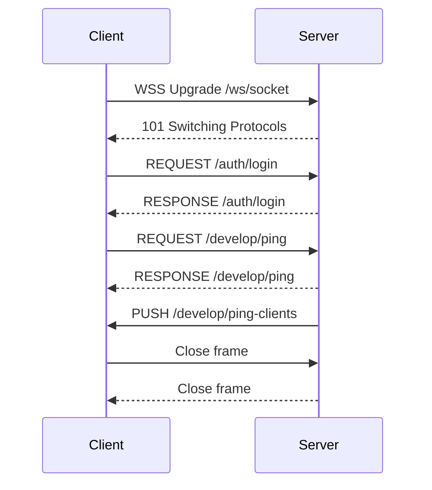

# WebSocket Protocol Reference

## SocketMessage Format

All WebSocket communication uses the `SocketMessage` class from the `common` module. Messages are JSON-encoded with the following structure:

```json
{
  "type": "REQUEST|RESPONSE|PUSH|ERROR",
  "route": "/route/path",
  "messageId": "unique-message-id",
  "payload": {},
  "timestamp": 1699999999999
}
```

### Field Descriptions

| Field | Type | Required | Description |
|-------|------|----------|-------------|
| `type` | String | Yes | Message type: `REQUEST`, `RESPONSE`, `PUSH`, `ERROR` |
| `route` | String | Yes | WebSocket route (e.g., `/develop/ping`) |
| `messageId` | String | Yes | Unique identifier for request-response correlation |
| `payload` | Object | No | Route-specific payload data |
| `timestamp` | Long | Yes | Unix timestamp in milliseconds |

### Message Types

#### REQUEST
Sent by client to invoke a server route. Server responds with RESPONSE.

```json
{
  "type": "REQUEST",
  "route": "/auth/login",
  "messageId": "msg-123",
  "payload": {
    "email": "student@example.com",
    "password": "secret"
  },
  "timestamp": 1699999999999
}
```

#### RESPONSE
Sent by server in reply to a REQUEST. Contains result or error.

```json
{
  "type": "RESPONSE",
  "route": "/auth/login",
  "messageId": "msg-123",
  "payload": {
    "success": true,
    "userId": 42,
    "role": "STUDENT"
  },
  "timestamp": 1699999999999
}
```

Error response:
```json
{
  "type": "RESPONSE",
  "route": "/auth/login",
  "messageId": "msg-123",
  "payload": {
    "success": false,
    "error": "Invalid credentials"
  },
  "timestamp": 1699999999999
}
```

#### PUSH
Server-initiated message sent to client without a preceding REQUEST. Used for notifications.

```json
{
  "type": "PUSH",
  "route": "/develop/ping-clients",
  "messageId": "push-456",
  "payload": {
    "message": "Server broadcast"
  },
  "timestamp": 1699999999999
}
```

#### ERROR
Protocol-level error (malformed message, unknown route, etc.).

```json
{
  "type": "ERROR",
  "route": "",
  "messageId": "",
  "payload": {
    "code": "UNKNOWN_ROUTE",
    "message": "Route /unknown not found"
  },
  "timestamp": 1699999999999
}
```

## Registered Routes

### Authentication Routes

#### `/auth/login`
Authenticates a user against the database.

**Request Payload:**
```json
{
  "email": "string",
  "password": "string"
}
```

**Response Payload (success):**
```json
{
  "success": true,
  "userId": 42,
  "role": "STUDENT|INSTRUCTOR",
  "sessionToken": "uuid"
}
```

**Response Payload (failure):**
```json
{
  "success": false,
  "error": "Invalid credentials"
}
```

#### `/auth/logout`
Removes the requesting session from the logged-in set.

**Request Payload:** Empty object `{}`

**Response Payload:**
```json
{
  "success": true
}
```

### Development Routes

#### `/develop/ping`
Simple health check. Returns pong.

**Request Payload:** Empty object `{}`

**Response Payload:**
```json
{
  "type": "PONG",
  "timestamp": 1699999999999
}
```

#### `/develop/ping-clients`
Pushes a ping to every connected client. Used for testing broadcast functionality.

**Request Payload:** Empty object `{}`

**Response Payload:**
```json
{
  "success": true,
  "clientsNotified": 5
}
```

Each connected client receives a PUSH message:
```json
{
  "type": "PUSH",
  "route": "/develop/ping-clients",
  "messageId": "push-789",
  "payload": {
    "message": "Broadcast from server"
  },
  "timestamp": 1699999999999
}
```

#### `/develop/last-pong`
Returns the last pong recorded from a client.

**Request Payload:** Empty object `{}`

**Response Payload:**
```json
{
  "lastPong": 1699999999999,
  "clientId": "session-uuid"
}
```

## Client Implementation

### Java Client (common module)

The `SocketMessage` class provides static factory methods:

```java
// Create a request
SocketMessage request = SocketMessage.request("/develop/ping");

// Create a request with payload
SocketMessage login = SocketMessage.request("/auth/login", 
    Map.of("email", "user@example.com", "password", "secret"));

// Send and receive
client.send(request);
SocketMessage response = client.receive("/develop/pong", 5, TimeUnit.SECONDS);
```

### Connection Lifecycle



### Reconnection Logic

The desktop client implements automatic reconnection:

1. On disconnect, wait 1 second
2. Attempt reconnection (max 5 attempts)
3. On successful reconnect, re-authenticate if needed
4. Resume message processing

### Message Correlation

Each REQUEST gets a unique `messageId` (UUID). The client matches RESPONSE to REQUEST using this ID. The `SocketClient` class maintains a `ConcurrentHashMap<String, CompletableFuture<SocketMessage>>` for pending requests.

## Server-Side Route Registration

Routes are registered using annotations in the `server` module:

```java
@WebSocketEndpoint
public class DevelopEndpoint {

    @WebSocketRoute("/develop/ping")
    public SocketMessage ping(SocketMessage request, Session session) {
        return SocketMessage.response(request.getRoute(), 
            Map.of("type", "PONG", "timestamp", System.currentTimeMillis()));
    }

    @WebSocketRoute("/develop/ping-clients")
    public SocketMessage pingClients(SocketMessage request, Session session) {
        // Broadcast to all sessions
        sessionRegistry.getAllSessions().forEach(s -> {
            s.send(SocketMessage.push("/develop/ping-clients", 
                Map.of("message", "Broadcast from server")));
        });
        return SocketMessage.response(request.getRoute(), 
            Map.of("success", true, "clientsNotified", sessionRegistry.getAllSessions().size()));
    }
}
```

The `@WebSocketEndpoint` annotation marks the class for component scanning. The `@WebSocketRoute` annotation maps a route path to a handler method.

## Testing WebSocket Routes

### Using the Communication Test

```bash
make communication-test
```

This runs `infra/communication-test.sh` which:
1. Connects to the WebSocket endpoint
2. Sends ping, waits for pong
3. Tests broadcast by calling `/develop/ping-clients`
4. Verifies all connected clients receive the push

### Manual Testing with Client JAR

```bash
# Interactive mode (opens connection window)
java -jar client/target/client-1.0-SNAPSHOT-all.jar

# Direct mode
java -jar client/target/client-1.0-SNAPSHOT-all.jar \
  --endpoint wss://localhost:8443/ws/socket /develop/ping --message ping
```

### Testing with wscat

```bash
# Install wscat
npm install -g wscat

# Connect (accept self-signed cert)
wscat -c wss://localhost:8443/ws/socket --no-check

# Send ping
> {"type":"REQUEST","route":"/develop/ping","messageId":"test-1","payload":{},"timestamp":1699999999999}
```

## Error Codes

| Code | Description |
|------|-------------|
| `UNKNOWN_ROUTE` | Route not registered |
| `INVALID_PAYLOAD` | Payload validation failed |
| `UNAUTHORIZED` | Authentication required |
| `SESSION_EXPIRED` | Session no longer valid |
| `INTERNAL_ERROR` | Server-side exception |
| `RATE_LIMITED` | Too many requests |

## Extending the Protocol

To add a new route:

1. Add handler method in appropriate endpoint class
2. Annotate with `@WebSocketRoute("/your/route")`
3. Handle REQUEST, return RESPONSE
4. For broadcasts, use `sessionRegistry.getAllSessions()` to send PUSH messages
5. Add client-side handling in `SocketClient` or Swing UI
6. Add integration test in `client/src/test/...`

The router scans for `@WebSocketEndpoint` classes at startup and builds the route map automatically.